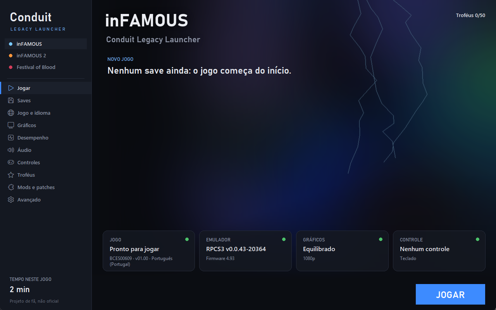

<p align="center"></p>

<h1 align="center">Conduit Legacy Launcher</h1>
<p align="center">An <b>unofficial</b> launcher for <b>inFAMOUS</b>, <b>inFAMOUS 2</b> and <b>inFAMOUS: Festival of Blood</b> (PS3) on PC, through RPCS3.</p>
<p align="center">English · <a href="README.pt-BR.md">Português</a></p>

> **Unofficial fan project.** Not affiliated with Sony Interactive Entertainment, Sucker Punch Productions or
> the RPCS3 team. **No game files come with the launcher**: you need your own copies, dumped from your own
> console. See [LEGAL.md](LEGAL.md).



Sibling of [Conduit Launcher](https://github.com/Fer-Magalhaes/conduit-launcher) (inFAMOUS Second Son).

## Features

- **One-click setup**: downloads RPCS3 from its official GitHub and the PS3 firmware from Sony's update
  server, without opening anything. `baixar-emulador.bat` does the same.
- **All three games in one place**, each with its own options; the emulator stays out of sight.
- **Per-game recommended settings** from RPCS3's compatibility database, applied for you.
- **Graphics**: 6 presets (Potato, Like on PS3, Performance, Balanced, Quality, Ultra), up to 4K, FSR,
  anisotropic filtering, VSync, FPS limit. Above 720p the "no mesh trimming" patch turns on by itself.
- **Performance**: SPU threads, thread scheduler (helps hybrid CPUs), weak-CPU mode, process priority.
- **Audio**: volume, stereo or surround, buffering, time stretching.
- **Controls**: detects your controller and picks RPCS3's right mode: XInput for Xbox/8BitDo, native for
  DualShock 4 and DualSense with rumble and light colour. Keyboard when there is no controller.
- **Trophies**: list with icons, grade and unlock date.
- **Saves**: mission, karma and completion per slot, automatic backup before playing, restore, export, import.
- **Patches and cheats** from RPCS3's database with switches: skip intro, field of view, no speed limit,
  all powers…
- **Drag-and-drop mods**: drop a `.zip` in the `mods` folder. Format in [docs/MODS.md](docs/MODS.md).
- **Installer for your own .pkg / .iso** files, limited to the tested releases.
- **PSN releases** with encrypted (SDAT) files are decrypted by themselves into a copy; `.rap` licences next
  to the game are installed automatically.
- Play time, Steam and desktop shortcuts, Discord status.
- Game files are never changed: RPCS3 sees them through links, and mods are a separate layer.

## Install

1. Get the newest `.zip` from **[Releases](../../releases)** and extract it.
2. Open **Conduit Legacy Launcher.exe**. Click the **Emulator** tile to download RPCS3 and the firmware
   (about 240 MB).
3. In **Game and language**, choose each game's folder, or put the games in the `jogos` folder (one sub-folder
   per game) and the launcher finds them. You can also use **Install .pkg / .iso** there (see below).
4. Press **PLAY**.

### Installing from .pkg / .iso

**Game and language > Install .pkg / .iso** installs your own files into `jogos`. You can pick several at
once, such as the game, its update and the `.rap` licence. Only the releases this launcher was tested with
are accepted; anything else is refused:

| Game | File | Release |
|---|---|---|
| inFAMOUS | `.iso` (decrypted disc dump) | BCES00609 |
| inFAMOUS 2 | `.pkg` (game and update) | NPUA98125, BCUS98125 |
| Festival of Blood | `.pkg` + `.rap` | NPUA80657 |

PKGs are installed by RPCS3 itself. Disc images must already be decrypted (as the usual PS3 dump tools
make them): the launcher does not decrypt discs and refuses encrypted images. It never downloads games.

| Game | Folder | Releases |
|---|---|---|
| inFAMOUS | the disc folder, with `PS3_GAME` inside | BCES00609 (tested), BCUS98119, BCES00220, NPUA80480… |
| inFAMOUS 2 | game and update side by side (e.g. `NPUA…` and `BCUS98125`) | BCUS98125 (tested), NPUA80638, BCES01143… |
| Festival of Blood | `NPUA80657` and its `.rap` licence | NPUA80657 (tested), NPEA00322 |

Each game's first start is slow: RPCS3 compiles the game's code and shaders.

## Tips

- Start with **Balanced**; if the FPS drops, try **Performance** (720p with FSR), and on 12th-gen-or-newer
  Intel CPUs the "RPCS3 alternative" scheduler.
- "Add to Steam" (Advanced) turns Steam Input off for the shortcut so the controller reaches the game.
- In game, **Alt+Enter** toggles full screen; closing the game window goes back to the launcher.

## Troubleshooting

| Problem | Fix |
|---|---|
| "PS3 firmware missing" | Advanced > "Install firmware". |
| RPCS3 won't start | Advanced > install Microsoft Visual C++. |
| Black screen on PSN inFAMOUS 2 | The first start decrypts its files (a few minutes). Wait. |
| Objects disappear / holes | Keep the "no mesh trimming" patch on (automatic above 720p). |
| Controller does nothing | Turn it on before pressing PLAY; Controls shows the detected type. |
| Something went wrong | Advanced > "View log" and open an issue with it. |

## Building

```bat
pip install -r requirements.txt
build.bat
```
Output: `dist\Conduit Legacy Launcher`. A `v*` tag makes GitHub Actions build and release the `.zip`.
Translations: `python tools\i18n_check.py`.

## Credits and license

Launcher code: [MIT](LICENSE). RPCS3, the firmware and the patches belong to their authors: see
[CREDITS.md](CREDITS.md) and [LEGAL.md](LEGAL.md).
